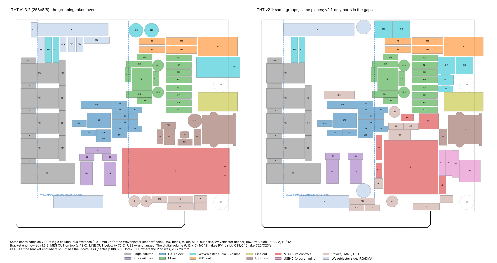

# PicoGUS THT v2.1 – PicoGUS 2.0 in through hole, on a Waveshare Core2350B (RP2350B)

Board revision **v2.1**: the [PicoGUS 2.0](../hw-chipdown) circuit (chip-down RP2040, SMD) rebuilt for hand assembly
with through-hole parts. The RP2040, its flash, crystal and core regulator are replaced by a
**Waveshare Core2350B2** module (RP2350B, 16 MB flash, **8 MB PSRAM**) on four 2x8 sockets, and the module's PSRAM is
the GUS sample RAM, so v2.0's separate APS6404L is gone. Everything else is v2.0's circuit with the same GPIO map:
ISA bus logic, PCM5100A DAC, M62429 Waveblaster volume, MIDI out, USB-A host port and IRQ/DMA jumpers. The card is
the [THT v1.3.2](../hw-tht-v1.3.2/README.md) outline (102.0 × 99.95 mm), with v1.3.2's bracket-side connectors (USB-A,
line out, MIDI out) and bracket tab holes in v1.3.2's places, so the [v1.3.2 bracket](../hw-tht-v1.3.2/README.md#bracket) fits.
v2.0's passive line-out mix (four 1k resistors) is replaced by the **op-amp mixer of the THT v1.3 boards** (NE5532 on
ISA ±12 V, Waveblaster +6 dB), with film coupling capacitors and a DC-coupled DAC path.

The parts that only exist as SMD are soldered on the card: U1/U2 (SN74CB3T3257, TSSOP-16) and U10 (PCM5100A,
TSSOP-20) on THT v1.3.2's test-pad TSSOP footprints (hand-solder toes and a 0.7 mm test pad per pin), U13 (M62429L)
on v2.0's SOIC-8. Everything else is through hole; see
[Parts with no through-hole version](#parts-with-no-through-hole-version).

> **Status: schematic done; board placed but not routed: the placement is up for review before routing. Not built
> or tested. Firmware: ported and built (`picogus-v21.uf2`), not tested on hardware** (see [Firmware](#firmware) and
> [Layout status](#layout-status)).

Files:

| File | What |
|---|---|
| `PicoGUS-THT.kicad_pro/.kicad_sch/.kicad_pcb/.kicad_dru` | KiCad **10** project. Root sheet: v2.0's ISA logic, power, USB, Waveblaster and module |
| `audio.kicad_sch` | PCM5100A DAC sheet (v2.0's, footprints only) |
| `mixer.kicad_sch` | Line-out mixer: NE5532 inverting summing amplifier (from THT v1.3), ±12 V filters, Waveblaster input pull-downs |
| `PicoGUS-THT-schematic.pdf` | Schematic PDF |
| `BOM-THT.csv` | BOM with a **THT status** column (THT / THT but a different part than v2.0 / no THT version exists / module), the v2.0 part each line replaces, manufacturer, MPN, DigiKey and LCSC numbers, a digikey.no link, alternatives and digikey.no prices; then the kit items (module sockets and headers, jumpers), the optional IC sockets and the v2.0 parts that are gone |
| `BOM-THT-digikey-upload.csv` | DigiKey cart/BOM upload (see [Cost](#cost)). Customer Reference `PicoGUS-THT-2.1.x: <references>` on every line, so the bags of a mixed order say which board they are for; at most 48 characters (DigiKey prints "Character Limit Exceeded" instead of a longer one), so the 15 × 0.1 µF line reads `C2-7,14-16,20,…` |
| `BOM-THT-sockets.csv` (+ `-digikey-upload`) | Optional: every IC socketed, with socket and part heights against the Waveblaster daughterboard. The same parts are the optional socket lines of `BOM-THT.csv` |
| `tools/digikey_upload.py` | Writes both DigiKey upload files from `BOM-THT.csv` (`python3 tools/digikey_upload.py [cards]`; more than one card gives `-<n>x` files) |
| `tools/gen_core2350b.py` | Generates the Core2350B footprint and 3D model in `hw-common` and checks the pin map |
| `PicoGUS-THT-top.png`, `PicoGUS-THT-bottom.png` | 3D renders |

The shared `PiGUS library` footprints are linked from `hw-common/`. **New in the shared library for v2.1:**
`Waveshare_Core2350B` (with a generated 3D model, `hw-common/parts/Waveshare_Core2350B.wrl`),
`USB_C_Receptacle_GCT_USB4085`, `TSSOP-16_4.4x5mm_P0.65mm_HandSolder_TestPads` and
`TSSOP-20_4.4x6.5mm_P0.65mm_HandSolder_TestPads` (THT v1.3.2's: KiCad's TSSOP with the toes to ±3.9 mm and one
0.7 mm round test pad per pin in two staggered columns per side, at x ±4.45 / ±5.1 mm),
`USB_A_Molex_67643_Horizontal_ShieldPin5` (KiCad's Molex 67643 with the shield pads
numbered 5, as the `USB_A` symbol's shield pin) and `DIP-8_W7.62mm_SOIC-8_Adapter` (no longer used here).

## What changed compared to v2.0

The schematic is v2.0's (`hw-chipdown`), upgraded to KiCad 10 and edited. Its netlist was compared with v2.0's
connection by connection: apart from the changes in this table the two are identical (119 multi-pin nets each).
Reference designators are v2.0's; new ones are D3, R19, R20 and C46.

| v2.0 | v2.1 | Why |
|---|---|---|
| U12 RP2040 (QFN-56), U11 W25Q128 flash, Y1 12 MHz crystal, R12/R14/R15/R16, C24–C37 (the RP2040 sheet) | **U12 Waveshare Core2350B** module on four 2x8 sockets (or soldered on its headers) | No chip-down RP2040 by hand. The module has the RP2350B, 16 MB flash, crystal, its own 3.3 V LDO and the 27 Ω USB resistors |
| U9 AMS1117-3.3 (SOT-223) | **U9 MCP1826S-3302E/AB** (TO-220) | Through hole, and 250 mV dropout: VSYS is now one Schottky drop below +5V (see [Power](#power)) |
| Q1 AO3401A ideal-diode switch (+5V → VSYS), R17 | **D3 1N5819** | No good TO-92 P-MOSFET; a second Schottky as for USB (D2) |
| J6 micro-USB (SMD) | **J6 GCT USB4085** through-hole USB-C + **R19/R20** 5.1 kΩ CC pull-downs | Through hole; device only, never sources VBUS |
| U6 74LVC2G06 (SOT-363), open-drain MIDI and I/O CH RDY drivers | **U6 74AHCT126** (DIP-14) on +5V + **C46** | No DIP open-drain inverter that runs on 3.3 V; the v1.3 THT boards' solution (OE = the old input, A tied low, so OE high pulls the line low). Spare gates tied low |
| U4/U5 74LVC00, U3 74AHC14, U7 SN74CB3T3245 (TSSOP) | 74AHC00 ×2, 74AHC14, **74AHC244** (DIP) | AHC: 3.3 V supply with 5 V tolerant inputs (as on v1.2/v1.3) |
| U1/U2 SN74CB3T3257, U10 PCM5100 (TSSOP) | same chips, **SMD on the card** (TSSOP-16/-20 on v1.3.2's hand-solder footprints with a test pad per pin) | No through-hole version exists |
| U8 APS6404L PSRAM (SOIC-8, GPIO0–3, PIO SPI) | **removed**: the Core2350B2's 8 MB PSRAM on the RP2350B's QMI (CS1 = GPIO47) | No through-hole PSRAM exists; the module's is memory mapped and faster. Needs the firmware port. GPIO0–3 are free |
| U13 M62429L (SOP-8) | same chip, **SMD on the card** (SOIC-8, v2.0's footprint) | The DIP-8 M62429P is not buyable |
| R6–R9 (1k passive mix), C43/C44 | **U11 NE5532 mixer** (sheet `mixer.kicad_sch`): R21–R32, C24–C29 | As THT v1.3: Waveblaster ×2 (+6 dB) and PCM ×1 summed, 100 Ω outputs, buffered line out |
| C39–C42 2.2 µF electrolytic (SMD) | **2.2 µF polyester film**, dual footprint (film on 5 mm, or a bipolar electrolytic on 2 mm) | Audio coupling: non-polar, low distortion |
| 0402/0603/0805/1206 R/C, CP_Elec_4x5.4, SOD-323, 0603 LED, 1206 PTC, 0805 beads, TL3305 switch, JST-SH debug | axial resistors and beads, radial MLCC discs and electrolytics, DO-41, 3 mm LED, radial PTC, 6 mm tactile switch, 1x3 header | Through hole |
| C11 47 µF (+3V3) | C11 10 µF | MCP1826S: at most 22 µF on its output |
| C38 100 µF ceramic | C38 100 µF electrolytic | Through hole |
| Card outline 102.87 × 96.74 mm, v2.0 bracket | **THT v1.3.2's outline** (102.0 × 99.95 mm) and bracket: J7 (MIDI out, top), J9 (line out) and J5 (USB-A, now v1.3.2's **Molex 67643**), H1/H2 and the ISA fingers at v1.3.2's positions | Reuses the v1.3.2 bracket; the 102 mm card is v1.3.2's cheaper JLCPCB size. The bracket's volume-pot hole is unused (v2.1's Waveblaster volume is digital) |
| 4 layers: In1 GND + AGND, In2 +3V3 + AVDD | 4 layers: In1.Cu GND plane, In2.Cu +3V3 plane; AGND/AVDD islands under the audio section to be drawn once the placement is settled | As v2.0 |
| `+3.3V` power symbols | `+3V3` | The RP2040 sheet joined the two names; without it they would have split |

Unchanged references: J1 (ISA), J3 (IRQ/DMA), J7 (MIDI out), J8 (Waveblaster), J9 (line out), H1/H2, and every
GPIO assignment except GPIO0–3 (PSRAM, now free). Board positions: see [Layout status](#layout-status).

## Parts with no through-hole version

These are the v2.0 parts that cannot be replaced by a through-hole part. Everything else on v2.0 has a DIP, TO-220,
axial or radial equivalent (`THT status` column of `BOM-THT.csv`).

| v2.0 part | Package | Why there is no THT replacement | v2.1 |
|---|---|---|---|
| **RP2040** (+ W25Q128 flash, 12 MHz crystal) | QFN-56, SOIC-8, 3225 | No THT microcontroller of this class | **Waveshare Core2350B2 module** (RP2350B QFN-80 + 16 MB flash + crystal + 8 MB PSRAM) on four 2x8 headers |
| **APS6404L** 8 MB PSRAM | SOIC-8 | No THT PSRAM; the largest DIP SRAM (23LC1024) is 128 KB, a GUS needs 1 MB | **On the module**: the Core2350B2's PSRAM (firmware port needed) |
| **SN74CB3T3257** ×2 (5 V tolerant bus switches) | TSSOP-16 (no DIP/SOIC) | TI makes it in TSSOP/SSOP/TVSOP/VQFN only; the ISA interface needs it | Same chip, **SMD on the card** (TSSOP-16, 0.65 mm pitch) |
| **PCM5100A** DAC | TSSOP-20 only | The whole PCM510x family is TSSOP-20 | Same chip, **SMD on the card** (TSSOP-20, 0.65 mm pitch) |
| **M62429** volume control | SOP-8 (DIP-8 M62429P discontinued) | No DIP part in stock at DigiKey or LCSC; DIP clones (FM62429, U2429) only at hobby shops | Same chip, **SMD on the card** (SOIC-8, 1.27 mm pitch) |
| micro-USB receptacle | SMD | – | **GCT USB4085** through-hole USB-C: through hole, but 0.85 mm contact pitch (the hardest joint on the card) |

Replaced by a different through-hole part (circuit change): 74LVC2G06 → **74AHCT126** (U6), AO3401A → **1N5819**
(D3), AMS1117 → **MCP1826S** (U9), 74LVC00 → 74AHC00, SN74CB3T3245/74LVC244 → 74AHC244.

## Cost

digikey.no prices of 2026-10-30, for one board, in NOK; shipping not included. Per-line prices are in `BOM-THT.csv`.

| | NOK excl. MVA | NOK incl. 25 % MVA |
|---|---|---|
| DigiKey order, `BOM-THT-digikey-upload.csv` (43 lines) | 580.00 | 725.00 |
| Optional IC sockets, `BOM-THT-sockets-digikey-upload.csv` (U3–U7, U11) | 58.98 | 73.72 |
| Both | 638.98 | 798.73 |

* **Not in the DigiKey order**: the Core2350B2 (waveshare.com, US$6.99) and the M62429L (LCSC C52260216, minimum 5),
  and the PCB.
* J5 is now v1.3.2's Molex 67643 (DK WM4993-ND, 16.58 NOK, price of 2026-10-31), so it is in the DigiKey order.
* **C39–C42** (2.2 µF film, 61 NOK) are on backorder at DigiKey until about April 2027: see the LCSC film part or the
  bipolar electrolytic in [Audio](#audio).

## Audio

* **DAC**: PCM5100A (U10) as v2.0, output RC filter R10/R11 470 Ω + **C0G** C21/C22 2.2 nF (polypropylene film
  WIMA FKP2 is the alternative). Charge pump and decoupling MLCCs per the TI datasheet (X7R).
* **Waveblaster volume**: M62429L (U13) on AVDD as v2.0, inputs pulled to AGND by 100k (R31/R32, as THT v1.3),
  **film** coupling capacitors in and out (C39–C42).
* **Mixer** (`mixer.kicad_sch`, THT v1.3's): U11 NE5532 inverting summing amplifier on ISA ±12 V through 10 Ω / 47 µF
  (R29/R30, C28/C29). Waveblaster through 10k (×2, +6 dB), PCM through 20k (×1), feedback 20k ‖ 47 pF C0G (pole about
  170 kHz), 100 Ω output resistors to the jack. The PCM5100A's output is ground centred, so the PCM path is DC coupled:
  no electrolytic anywhere in the PCM path. U11 can be socketed for an OPA2134PA.
* **Capacitor choices** (`Alternatives` column of the BOM): 2.2 µF film at 5 mm pitch is scarce: DigiKey had none in
  stock on 2026-10-29 (TDK B32529D0225J000 on backorder), LCSC has Faratronic C241J225J2SC000. The footprint also
  takes a 5 mm bipolar electrolytic (Rubycon 50NXA2R2MEFC5X11, in stock) on its inner holes. Nichicon's Muse ES/BP, FG
  and FW are discontinued in 5 mm cans, so AVDD bulk C38 is a Panasonic FR (EEU-FR1C101).

* **Ground and supply planes** (to be drawn once the placement is settled): as on v2.0, AGND and AVDD get copper
  islands on the inner layers (In1/In2) under the audio section: the DAC's analog pin row and its output filter, the
  Waveblaster's audio pins, the volume control, the film capacitors, the mixer and the line-out jack. They meet GND
  and +3V3 only at FB3 and FB4. The MIDI jack, the DAC's digital row and the Waveblaster's digital pins stay outside
  them, and digital tracks cross them only where they must (on the routed v2.1 draft: the volume control's clock and
  data, about 10 mm of MIDI/UART to the Waveblaster, 2 mm of the Waveblaster reset and 2 mm of BCK).

## Core2350B module

The Core2350B is 25.4 × 25.4 mm with 64 plated holes on a 2.54 mm grid: a 10×10 outer ring and an 8×8 inner
ring. Waveshare's schematic draws them as four 2x8 headers, P1–P4, arranged as a pinwheel, so **four standard 2x8
female headers** take the module (BOM lines `(U12 socket)` and `(U12 headers)`). The footprint numbers the pads
16·(header − 1) + pin. Seen from the top, pin 1 of each header is a GND corner; the module's chamfered corner
(pad 1, P1.1) is at the top left:

```
  G   0  VB  3E RUN UDP UDM  BS  47   G      VB  VBUS (module LDO input)      3E  3V3_EN (100k up to VBUS)
  2   1 3V3   G  AV  SC   G  SD  46  45      3V3 module LDO output            AV  ADC_VREF
  4   3                          43  44      UDP/UDM  USB D+/D- (27R inside)  SC/SD  SWCLK/SWDIO
  6   5                          41  42      BS  BOOTSEL                      G   GND
  8   7                          39  40      numbers: GPIO
 10   9                          37  38
 12  11                          35  36      P1 = left two columns (GPIO0-14)
 14  13                          33  34      P2 = top two rows (USB, SWD, RUN, BOOTSEL, power, GPIO45-47)
 15  16  18  20  22  24  26  28  31  32      P3 = bottom two rows (GPIO15-29)
  G  17  19  21  23  25  27  29  30   G      P4 = right two columns (GPIO30-44)
```

Source: Waveshare's [Core2350B schematic](https://files.waveshare.com/wiki/Core2350B0/Core2350B.pdf) (P1–P4) and
[pinout drawing](https://www.waveshare.com/wiki/Core2350B0); `tools/gen_core2350b.py` checks that every GPIO
appears once and that the cells form the two rings. On the module: the user LED is on **GPIO39**, and on the
Core2350B1/B2 the PSRAM chip select (QMI CS1) is **GPIO47** (through a 0 Ω link to the edge pin).

* **U12 is placed at 0°**: GPIO0–14 (P1) face the logic on the left, GPIO15–29 (P3) face the ISA fingers,
  USB/SWD/RUN/BOOTSEL/power (P2) face up and the unused GPIO30–44 (P4) face the bracket.
* **Variants**: Core2350B0 (no PSRAM, $4.99), B1 (2 MB, $5.99), **B2 (8 MB, $6.99, recommended)**; the `-Kit`
  versions add Waveshare's USB-C FPC adapter. Not sold by DigiKey: buy from waveshare.com (SKU 31690 for the B2) or a
  Waveshare reseller.
* **Heights**: on 8.5 mm female headers the module's top is at about 12 mm. It sits right of the Waveblaster
  daughterboard area, so that is fine. Soldered straight into the card on its male headers, the module sits at about
  3.5 mm.

## GPIO map (= v2.0)

| GPIO | Net | GPIO | Net |
|---|---|---|---|
| 0–3 | free (v2.0: U8 PSRAM; the GUS RAM is the module's PSRAM now) | 16 | DIN (I2S to U10) |
| | | 17 | BCK |
| | | 18 | LRCK |
| | | 19 | ~RDACK |
| 4 | ~RIOW | 20 | RTC |
| 5 | ~RIOR | 21 | RIRQ |
| 6–13 | AD0–AD7 (U1/U2 bus switches) | 22 | RDRQ |
| 14 | RA8 | 23 | LED (D1) |
| 15 | RA9 | 24, 25 | RV_DATA, RV_CLK (U13 M62429) |
| 26 | RI/OCHRDY (U6) | 27 | ADS (U1/U2 select, U3) |
| 28 | UART_TX (MIDI, J4, Waveblaster) | 29 | GND (board ID, as v2.0) |
| 30–46 | not connected (39: module LED) | 47 | module PSRAM CS (QMI CS1), on the module |

## Power

* **VSYS** = +5V (ISA) through **D3** or USB VBUS (J6) through **D2**, both 1N5819 (as the Pico's VSYS). This
  replaces v2.0's AO3401A ideal diode: VSYS is about 0.3–0.4 V below +5V.
* **U9 MCP1826S-3302E/AB** (TO-220, 1 A, 250 mV dropout) makes the card's +3V3 from VSYS: logic, bus switches,
  DAC (AVDD through FB4) and M62429. With an AMS1117-class regulator (about 1.1 V dropout) a low ISA +5V would
  not leave enough headroom after the diode. Its pinout is VIN–GND–VOUT, tab GND (**not** the 1117 pinout, so an
  LD1117V33 does not fit). C11/C13 (10 µF) + C10 (1 µF) on its output: Microchip asks for at least 1 µF and at most
  22 µF.
* **The module powers itself**: VSYS goes to the module's **VBUS** pin, and its own LDO (ME6217C33, 800 mA, 3V3_EN
  pulled up on the module) makes the module's 3.3 V. The module's **3V3 pin is not connected**: the ME6217 must not
  see VOUT above VIN + 0.3 V, so it cannot be back-fed from U9. Both rails are 3.3 V ± 2 %; the RP2350's GPIO0–39 are
  5 V tolerant while it is powered and 3.3 V failsafe when it is not.
* The module's own FPC USB port (the `-Kit` adapter) also works for programming: its VBUS powers the module, and
  through the module's VBUS pin also VSYS and U9 (D2/D3 keep it off the ISA +5V and J6).

## USB

As on v2.0, the RP2350's one USB port goes to both **J5** (USB-A host: joystick, mouse, keyboard, storage, hub; VBUS
from +5V through F1) and **J6** (USB-C, for programming: BOOTSEL + drag-and-drop, and powering the card from USB
alone). Use one at a time. J6 has 5.1 kΩ Rd on CC1/CC2, so any USB-C charger or host supplies 5 V; it never sources
VBUS.

**J6 is a GCT USB4085-GF-A**, the through-hole USB-C 2.0 receptacle: 16 contacts on a 0.85 mm pitch in two rows (0.4
mm holes, 0.15 mm between pads), plus four shell legs. It is the hardest part to solder on the card: use a fine tip,
thin solder and flux, and check for bridges with a magnifier. The footprint has a 0.13 mm local pad clearance and
`PicoGUS-THT.kicad_dru` allows 0.13 mm / 0.4 mm hole-to-hole between J6's own pads (the board minimum clearance is
0.13 mm only for that; every netclass keeps 0.2 mm). The contacts' holes are 0.45 mm apart (GCT's land pattern):
check that the PCB fab accepts it.

## Firmware

**The firmware for v2.1 is on this branch, built but not tested on hardware**: `picogus-v21.uf2` (the multi-mode
bundle, like `picogus.uf2`) and single-mode `pg-*-v21.uf2` images. Build them with

```
sw/scripts/build_variants.sh -p picogus21 all
```

or `cmake -DPICO_PLATFORM=rp2350 -DPICO_BOARD=picogus21`. Details are in [sw/docs/rp2350.md](../sw/docs/rp2350.md#picogus-v21-tht-core2350b2-rp2350b):

* Built on the RP2350 port (Pico 2) merged from branch `claude/sweet-goodall-x5r6j6`, plus a board header
  (`sw/boards/picogus21.h`: RP2350B, 16 MB flash, PSRAM CS on GPIO47).
* **Board type at compile time**: v2.0 is recognised by GPIO29 on the ADC, which the RP2350B cannot do (its ADC is
  GPIO40–47), so the v2.1 build is a PicoGUS 2.0 by definition: LED on GPIO23, M62429 on GPIO24/25, same ISA, I2S
  and MIDI pins.
* **GUS sample RAM in the module's PSRAM** (QMI window 1, memory mapped). The GUS code's `psram_*` calls become memory
  accesses; at boot the PSRAM is identified, reset, switched to QPI and set up for quad reads/writes at 92.5 MHz
  (370 MHz / 4), with the read sample delay calibrated on a test pattern. The setup is re-applied after every clock
  change and settings save, and a settings save holds core 1 (which plays from the PSRAM) while the flash is written.
* Use the `-v21` files on this board: the bootloader and `pgusinit /flash` accept any RP2350 image and cannot tell
  a Pico 2 image from a v2.1 one.
* A Core2350B0 (no PSRAM) runs every mode except GUS, which stops at the PSRAM check.

## Mechanical

* **Outline**: THT v1.3.2's (101.90 × 99.85 mm at the line centres, 102.0 × 99.95 mm over the lines), without its
  Pico micro-USB relief slots.
* **Bracket end as on THT v1.3.2's final layout (commit 258c8f8)**, top to bottom: J7 MIDI OUT at (217.00, 49.00),
  J9 LINE OUT at (217.00, 75.50) and J5 USB-A (Molex 67643) at (208.64, 92.50), with the bracket tab holes H1/H2 at
  x 214.70 and the ISA fingers in v1.3.2's places, so the [v1.3.2 bracket](../hw-tht-v1.3.2/README.md#bracket) fits
  (its drawing is on User.Drawings). Its WT VOL hole between the two jacks stays unused: v2.1's Waveblaster volume is
  digital, and U13 with its output capacitors sits behind that hole, where v1.3.2 has RV1.
* **J6 (USB-C) at the bracket end**, centred at y 108.89, where v1.3.2 has the Pico's micro-USB. It faces the
  bracket with the footprint's PCB-edge line on the board edge, so its front is 2.5 mm past the edge (x 220.80), 0.9
  mm behind the inner face of the bracket drawing's plate. As on v1.3.2, the bracket has no hole there (v1.3.2's
  README: a USB plug cannot enter the slot opening at that height), so J6 is for programming and powering the card on
  the bench with the bracket off. In the PC, update the firmware with `pgusinit`.
* **J8 (Waveblaster)** with pin 1 where v1.3.2 has it, (158.89, 39.63), and v2.0's two daughterboard standoff holes
  (6.35 mm right of pin 1, at y 39.63 and 118.37). **J3 (IRQ/DMA)** at v1.3.2's position, pin 1 (136.03, 124.91).
* **Under the Waveblaster daughterboard** (a full-size board's outline ends at x 170.32 and y 121.9): only low parts.
  These are the logic DIPs, the SMD chips (U1, U2, U10), the DAC block, FB3/FB4, R31/R32 and the disc capacitors. The
  module, U9 (TO-220), the electrolytics, the film capacitors, F1, the LED and the user-facing headers and switch are
  all outside that area.

## Layout status

**Placed, not routed (2026-11-03), for review: the placement will change before routing.** It follows the grouping of
THT v1.3.2's final, routed layout (commit 258c8f8): every group the two boards share sits at v1.3.2's coordinates, and
the parts only v2.1 has fill the gaps. DRC with schematic parity: no parity issues. The only errors are the 11 accepted
courtyard overlaps of the logic column, and the unconnected items are the unrouted nets. The only warnings are 16
connector silkscreen lines past the bracket edge (J5, J6, J7 and J9 hang over it, as on v1.3.2).



| Group | v2.1 parts | Where (as on v1.3.2 unless noted) |
|---|---|---|
| Logic column | U6, U4, U5, U3 (DIP-14), U7 (DIP-20), C46, C5, C6, C4, C7, R1, R18, R5 | Left edge, pin 1 at x 120.07, y 65.62 / 77.67 / 89.71 / 101.76 / 113.81; discs above each VCC pin; resistors at x 138.60 |
| Bus switches | U1, U2 (TSSOP-16, test pads), C2, C3 | v1.3.2's U3/U4 at 90°, **0.9 mm higher** (U2 clears the lower Waveblaster standoff hole): (150.22, 109.20) / (161.44, 109.22); C2/C3 0.4 mm higher at y 101.89 |
| DAC block | U10 (TSSOP-20, test pads), C14–C22, R10, R11, FB4 | U10 at (156.10, 84.53), 180°: I2S/DVDD/LDOO on the west side, analog pins east, facing the output filter and the mixer. C16 (CPVDD) and C15 (AVDD) in the slots of v1.3.2's C36 and C13 |
| Mixer | U11, R21–R30, C24–C29 | U11 at (173.00, 61.00), 0°, feedback discs on its pins, ±12 V filters around it; the resistor columns at x 189.43 / 199.58 |
| Waveblaster audio + volume | R31/R32, C39/C40, U13, C41/C42, C23 | R31/R32 next to the header's audio pins (v1.3.2's R14/R15); C39/C40 where v1.3.2 has C22/C23; U13 with C41/C42 and C23 in RV1's slot behind the WT VOL hole, next to R21/R22 |
| MIDI out | R2, R3, FB1, FB2, J7 | Along the top edge to J7, as v1.3.2's R3/R4/FB1/FB2 |
| USB-A | J5, F1 | J5 as before; F1 standing left of it, where v1.3.2 has its F1 |
| Module | U12 (Core2350B) | Where v1.3.2 has the Pico: (187.96, 107.14), 0°, courtyard 175.0–201.0 × 94.1–120.1. Bus pins face U1/U2, I2S and the ISA-side signals face the fingers, USB/SWD/RUN/BOOTSEL/VSYS face up |
| Above the module | U9 (LDO), C12, C13, C38, SW1, J10 | U9's VSYS pin over the module's VSYS pin; C38 (AVDD bulk) at the DAC block's east end; BOOTSEL and RUN within reach of their pins |
| USB-C column | J6, R19, R20, D2, J2 | Between the module and the bracket: CC resistors and the VBUS diode next to J6, SWD header below them |
| Bottom strip | C1, D3, J4, R13, D1, C10, C11, R4, C45 | As v1.3.2: C1 (+5V bulk) at v1.3.2's C2, D3 (ISA +5V to VSYS) over the +5V finger at v1.3.2's D1, J4 (UART) at v1.3.2's J6; LED, RUN pull-up/capacitor left of the module |
| Ground star | FB3 (GND to AGND) | In the free area under the daughterboard above the DAC block |

* **R21–R32 (mixer) are now on 10.16 mm pitch** like every other resistor on the card (they were 7.62 mm), so the
  mixer columns are v1.3.2's to the coordinate. Schematic and BOM updated.
* **References**: the parts at v1.3.2's coordinates carry v1.3.2's hand-placed references (shown or hidden as there).
* **Planes**: In1.Cu GND and In2.Cu +3V3 over the whole card; the AGND/AVDD islands come back once the placement is
  settled (see [Audio](#audio)).
* **Silkscreen**: `MIDI OUT` above J7 as on v1.3.2, `LINE OUT` beside J9, the title in the top-right corner where
  v1.3.2 has its copper logo; on the back, the title, copyright, licence, project URL and thanks in the free area
  under the daughterboard.
* An earlier draft on the v2.0 outline was routed (commit `1028cb0`); its routing rules (nothing between the gold
  fingers, digital tracks off the analog islands) carry over.
